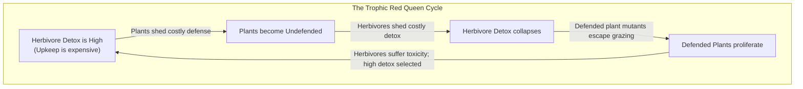
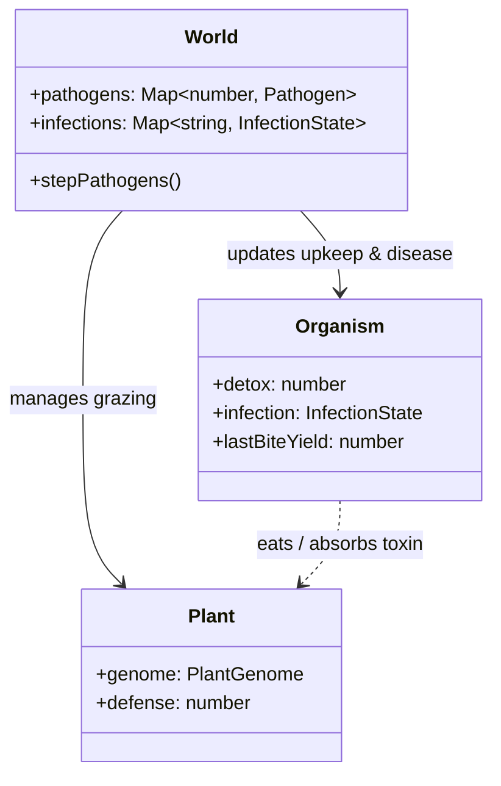

# Spec: Red Queen Coevolutionary Dynamics

_Status: Proposed specification (2026-10-27). Addresses evolutionary homeostasis/stagnation via antagonistic biotic coevolution. Unifies Roadmap Phase 2 Item 9 ("Evolving pathogen") and Phase 3 Item 10.3 ("Plant defense and herbivore detox"). Follows [`WORLD_RULES.md`](../../WORLD_RULES.md) and [`AGENTS.md`](../../AGENTS.md)._

## Executive Summary

After ~2,000–5,000 ticks in a static or strictly periodic world, natural selection drives organisms to a single Evolutionarily Stable Strategy (ESS). Purifying/stabilizing selection eliminates novel variation, and genetic drift strips founder diversity down to a single dominant lineage.

The **Red Queen Hypothesis** (Van Valen 1973, Hamilton 1980) states that in coevolutionary systems, organisms must constantly evolve and adapt simply to maintain current fitness against adapting counter-species. This specification details two coupled antagonistic coevolutionary engines that create a **perpetually non-stationary fitness landscape**:

1. **Trophic Arms Race (Plant Chemical Defense vs. Herbivore Detoxification)**: A continuous bi-directional cycle between plant toxicity/unpalatability and organism metabolic digestive enzyme investment.
2. **Epidemiological Arms Race (Density-Dependent Pathogens & Negative Frequency-Dependent Selection)**: Strain-specific pathogens that decimate dense, genetically uniform monocultures, granting rare alleles an intrinsic survival advantage.

Both engines start **on by default** behind individual switches (`plantDefenseEnabled`, `pathogenEnabled`), with switch-off bit-identity preserving existing fingerprints.

---

## 1. Loop 1: Plant Defense vs. Herbivore Detox (Trophic Arms Race)

### 1.1 Biological Principle
In the current world, plants are passive resources: they evolve growth and rooting strategies, but never resist grazing. Consequently, herbivores have no culinary challenge and quickly optimize for passive foraging.

Under this loop:
- Plants evolve chemical or structural defenses (e.g., secondary metabolites, tannins, thorns) that reduce edible yield or inflict metabolic malaise on grazers.
- Organisms evolve an inherited metabolic `detox` trait that neutralizes plant defenses at the cost of continuous metabolic enzyme upkeep.
- When plants are undefended, herbivores shed detox upkeep to conserve energy. As herbivore detox drops, defended plant mutants suddenly gain an escape from grazing and spread. In response, herbivores must re-evolve detox or starve.



### 1.2 Plant Defense Trait
Added to `PLANT_TRAITS` in [`src/sim/plants.ts`](file:///home/jcoleman/Projects/artificial-life/src/sim/plants.ts):
```typescript
defense: {
  min: 0,
  max: 1.0,
  founderMin: 0.05,
  founderMax: 0.25,
  locked: 0.0,
}
```

- **Defense Upkeep / Growth Trade-off**:
  Synthesizing defensive compounds consumes metabolic energy. A plant pays continuous biomass upkeep scaled by its defense:
  $$\text{upkeep}_{\text{defense}} = \text{plantUpkeep} \times \text{size} \times (1 + \text{plantDefenseCostFactor} \times \text{defense})$$
  *(Default `plantDefenseCostFactor`: 0.5)*. Undefended plants grow faster and invest more in seed reproduction on open, safe ground.

- **Effect on Grazing**:
  When an organism bites a plant with defense $D \in [0, 1]$:
  - Let organism detox level be $X \in [0, 1]$.
  - The unneutralized toxin fraction is:
    $$T_{\text{eff}} = \max(0, D - X)$$
  - **Yield Degradation**: The edible energy harvested from the bite is discounted by effective toxicity:
    $$E_{\text{absorbed}} = \text{foodEnergyYield} \times (1 - \text{defenseYieldPenalty} \times T_{\text{eff}}) \times \text{digestiveEfficiency}$$
    *(Default `defenseYieldPenalty`: 0.75)*.
  - **Toxicity Damage (Malaise)**: If unneutralized defense exceeds a threshold ($T_{\text{eff}} > 0.3$), the toxic bite inflicts acute tissue irritation / gut damage:
    $$\Delta E_{\text{harm}} = \text{toxinMalaiseCost} \times (T_{\text{eff}} - 0.3)$$
    *(Default `toxinMalaiseCost`: 8.0)*.

### 1.3 Herbivore Detoxification Gene
Added to organism life-history traits in [`src/sim/lifehistory.ts`](file:///home/jcoleman/Projects/artificial-life/src/sim/lifehistory.ts) (Trait 51) and DNA genome mapping in [`src/sim/dna.ts`](file:///home/jcoleman/Projects/artificial-life/src/sim/dna.ts):
- Switch: `detoxGeneEnabled: boolean` (default: `true`).
- Slider: `detox` $\in [0, 1.0]$, step `0.05`, bounds `[0, 1.0]`.
- Founders: Uniform in `[0.05, 0.2]`.
- **Enzyme Upkeep**:
  Maintaining digestive enzymes and liver filtration carries a constant tick cost proportional to body mass:
  $$\Delta E_{\text{upkeep}} = \text{detoxUpkeepRate} \times \text{detox} \times \text{size}$$
  *(Default `detoxUpkeepRate`: 0.03)*. At max detox (1.0), a normal organism pays ~12% of its basal metabolic rate.

### 1.4 Sensory Discrimination (Append-Only Brain Input)
To enable active behavioural discrimination without hardcoded instincts:
- Append `lastBiteYield` to `BRAIN_INPUTS` in [`src/sim/brain.ts`](file:///home/jcoleman/Projects/artificial-life/src/sim/brain.ts):
  - Normalized energy returned from the organism's most recent bite relative to nominal yield ($[0, 1]$).
  - Organisms can learn to linger on tasty plants and move away after tasting a bitter/defended plant.

---

## 2. Loop 2: Density-Dependent Pathogens & NFDS (Epidemiological Arms Race)

### 2.1 Biological Principle
In nature, pathogens act as a major brake on monoculture dominance. When a single genotype or lineage proliferates, it provides a dense, contiguous transmission substrate. A pathogen adapted to that host signature causes an epidemic crash.

This generates **Negative Frequency-Dependent Selection (NFDS)**:
- Common genotypes suffer high epidemic mortality.
- Rare genotypes (with divergent surface tags or immune configurations) are resistant to the prevailing pathogen strain, enjoying high survival and reproductive success.
- Stabilizing selection is permanently broken: genetic diversity is actively protected.

### 2.2 Pathogen Entity & Transmission Dynamics
Pathogens are modeled as lightweight transmissable vectors:
```typescript
export interface Pathogen {
  readonly id: number;
  targetTag: number; // Host tag hue [0, 360) this strain is specialized to infect
  virulence: number; // Metabolic drain / mortality severity [0.1, 1.0]
  transmissibility: number; // Base probability of jumping per contact [0.1, 0.8]
}

export interface InfectionState {
  pathogen: Pathogen;
  viralLoad: number; // Current infection severity [0.0, 1.0]
  ticksRemaining: number; // Course of infection before clearance or death
}
```

- **Transmission Vectors**:
  - Direct contact: Organisms sharing an adjacent Chebyshev cell or squeezing past each other.
  - Environmental fomite: Carrion corpses retain active viral load for half their rotting lifetime.
  - Downwind aerial drift: High winds (`weatherWindCoupling`) carry spore transmission downwind.

- **Strain-Host Tag Compatibility**:
  Infection probability scales with genetic similarity between host tag $\theta_h$ and pathogen target tag $\theta_p$:
  $$\Delta \theta = \min(|\theta_h - \theta_p|, 360 - |\theta_h - \theta_p|)$$
  $$P_{\text{infect}} = \text{transmissibility} \times \cos^2\left(\frac{\Delta \theta}{360} \times \pi\right)$$
  If the host's tag diverges by $\ge 90^\circ$ from the pathogen's target, the host is completely immune to that strain.

- **Pathogen Mutation (Red Queen Tracking)**:
  When a pathogen replicates into a new host, its `targetTag` mutates with probability `pathogenMutationRate` (0.15) with standard deviation $15^\circ$. Pathogens continually track whichever host lineage is currently most populous.

- **Host Pathology & Recovery**:
  - Infected organisms suffer an additional tick upkeep:
    $$\Delta E_{\text{fever}} = \text{pathogenDamageRate} \times \text{viralLoad}$$
  - High viral load ($> 0.6$) temporarily locks the organism out of mating/reproduction.
  - Survivors clear the infection after `infectionDuration` (default: 80 ticks) and acquire transient immunity (antibodies) for 300 ticks against that strain.

---

## 3. Architecture & Data Structures



### 3.1 Flat Decoded Arrays
Consistent with Tier 1 basic physical genes, `detox` is decoded once at birth into the organism's flat buffer:
- `organism.detox`: number (clamped to $[0, 1]$).
- Zero-dose fallback: If `detoxGeneEnabled = false`, defaults to $0.0$ with zero upkeep.

### 3.2 State Serialization & Migrations
- `WorldState.plantCounters` extended with:
  - `plantDefenseMean: number`
  - `plantToxBitesTotal: number`
- `WorldState` optionally serializes `activePathogens: PathogenState[]` when `pathogenEnabled` is true.
- Old snapshots without pathogen fields load cleanly with an empty pathogen map.

---

## 4. Performance & Budget Verification

- **Plant Defense Check**: Evaluated only during `EAT` actions ($\approx 10\text{--}40$ per tick total). Complexity is $O(1)$ arithmetic.
- **Pathogen Transmission**: Evaluated strictly on organisms that are already adjacent (reusing the existing spatial collision/movement grid). No global distance loops.
- **Tick Time Impact**: Target $< 3.5\%$ overhead at 500 organisms on the reference container, comfortably within the 5% `WORLD_RULES.md` budget.

---

## 5. UI, Mobile Ergonomics & Visuals

1. **Renderer (Dark Theme / Samsung Galaxy S21)**:
   - **Defended Plants**: Rosettes develop spiky/brambled geometric serrations and darker purple/forest accents as `defense` approaches 1.0.
   - **Pathogen Visuals**: Infected organisms display a subtle pulsing aura or particle spores in the hue of the infecting strain.
   - **New Overlay ("Pathogens & Disease")**: Heatmap showing local infection density and active viral plumes.
2. **Inspector**:
   - Plant Card: Displays `Defense: 42% (Upkeep: +0.005/tick)`.
   - Organism Card: Displays `Detox: 35% (Upkeep: -0.01/tick)` and `Health: Infected (Strain #184 - 45 ticks left)`.
3. **Trends Dashboard**:
   - New Coevolution chart: Co-plotted time-series of mean `Plant Defense` vs. mean `Herbivore Detox`.
   - Pathogen chart: Active strains, total infected population, and lineage casualty counts.

---

## 6. Phased Implementation Roadmap

* **Phase 1: Trophic Chemical Coevolution**
  - Add `defense` to `PLANT_TRAITS`.
  - Add `detox` gene (Trait 51) to `lifehistory.ts` and `dna.ts`.
  - Wire grazing yield discount and toxin malaise into `world.ts`.
  - Unit tests verifying energy conservation, enzymatic upkeep, and switch-off bit-identity.
* **Phase 2: Sensory Feedback & Plant Discrimination**
  - Append `lastBiteYield` to `BRAIN_INPUTS`.
  - Visual plant styling for defense.
* **Phase 3: Density-Dependent Pathogens (NFDS)**
  - Implement `pathogenEnabled` vector transmission and strain-host tag matching.
  - Pathogen infection overlay and trends graphs.

---

## 7. Open Decisions for User Review

1. **Pathogen Lethality**: Should severe infection directly kill organisms when energy is low, or act primarily as an energetic drain / reproductive inhibitor? (Recommended: energetic drain + reproductive lock, which causes mortality via starvation naturally without hardcoded execution).
2. **Toxicity Mode**: Should plant defense cause purely reduced edible yield, or both reduced yield and acute damage when detox is low? (Recommended: both, so high toxicity actively punishes naive grazers).