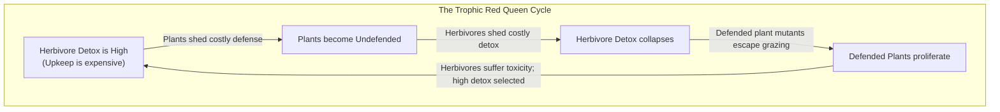
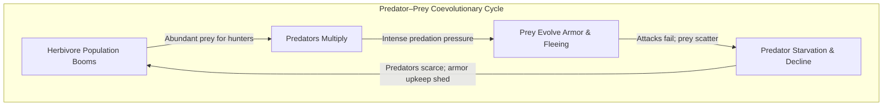
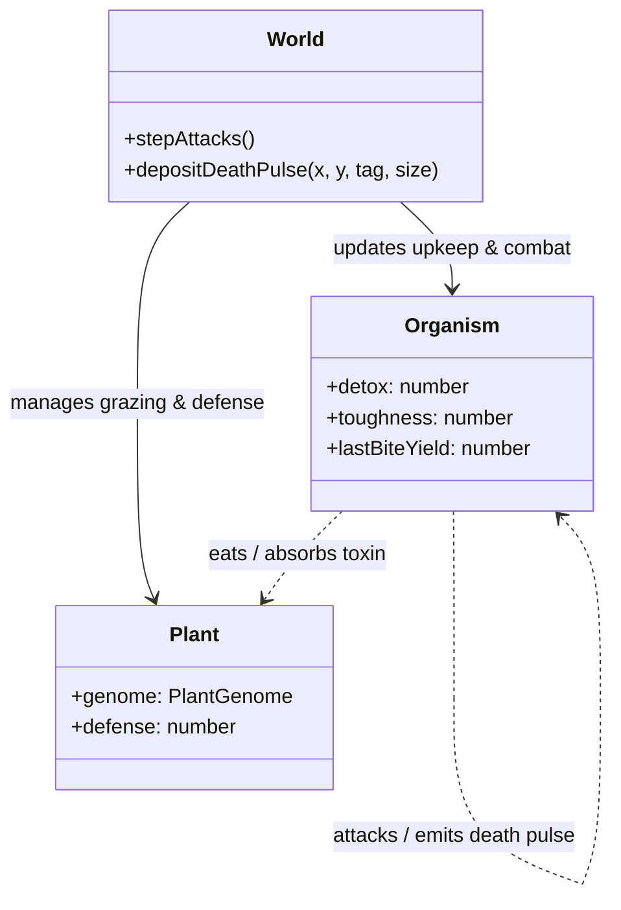

# Spec: Red Queen Coevolutionary Dynamics & Predator–Prey Arms Race

_Status: Approved specification (2026-10-27). Replaces pathogens with an authentic Predator–Prey Arms Race and couples it with Trophic Plant Defense vs. Herbivore Detox. Follows [`WORLD_RULES.md`](../../WORLD_RULES.md) and [`AGENTS.md`](../../AGENTS.md)._

## Executive Summary

After ~2,000–5,000 ticks in a static or strictly periodic world, natural selection drives organisms to a single Evolutionarily Stable Strategy (ESS). Stabilizing selection eliminates novel variation, and genetic drift strips founder diversity down to a single dominant lineage.

The **Red Queen Hypothesis** (Van Valen 1973) states that organisms in coevolutionary ecosystems must continuously adapt and evolve simply to maintain current fitness against adapting counter-species. This specification details two coupled antagonistic coevolutionary engines that create a **perpetually non-stationary fitness landscape** without artificial omniscient radars or hardcoded behavioral scripts:

1. **Trophic Arms Race (Plant Chemical Defense vs. Herbivore Detoxification)**: A continuous bi-directional cycle between plant chemical/structural defense and organism metabolic liver/digestive enzyme investment.
2. **Predator–Prey Arms Race (Prey Toughness, Involuntary Death Pulses & Emergent Evasion)**: An antagonistic coevolutionary cycle between predator hunting and prey defenses:
   - **Involuntary Death Pulse**: Violent kills release an acoustic/chemical shockwave with the victim's genetic tag into the physical signal grid, allowing kin to evolve scattering flight.
   - **Carrion Scent Uncoupling**: Sensed carcass direction is uncoupled from diet, allowing herbivores to evolve aversion to kill sites while carnivores pursue them.
   - **Prey Armor / Toughness**: Evolvable body toughness trait (Trait 52) that reduces bite fatality at the price of continuous metabolic mass upkeep.
   - **Allometric Size Divergence**: Physical scaling of energy capacity, combat survival, and movement agility naturally bifurcates populations into armored megafauna, agile microfauna, and pursuit carnivores.

Both engines start **on by default** behind individual switches (`plantDefenseEnabled`, `predationDefenseEnabled`), with switch-off bit-identity preserving existing fingerprints.

---

## 1. Loop 1: Plant Defense vs. Herbivore Detox (Trophic Arms Race)

### 1.1 Biological Principle
In the current world, plants are passive resources: they evolve growth and rooting strategies, but never resist grazing. Consequently, herbivores face no biochemical challenge and quickly optimize for passive foraging.

Under this loop:
- Plants evolve chemical or structural defenses (e.g., secondary metabolites, tannins, thorns) that reduce edible yield and inflict acute gut damage on grazers.
- Organisms evolve an inherited metabolic `detox` trait that neutralizes plant defenses at the cost of continuous metabolic enzyme upkeep.
- When plants are undefended, herbivores shed detox upkeep to conserve energy. As herbivore detox drops, defended plant mutants suddenly gain an escape from grazing and spread. In response, herbivores must re-evolve detox or suffer severe toxicity.



### 1.2 Plant Defense Trait
Added to `PLANT_TRAITS` in [`src/sim/plants.ts`](file:///home/jcoleman/Projects/artificial-life/src/sim/plants.ts):
```typescript
defense: {
  min: 0,
  max: 1.0,
  founderMin: 0.05,
  founderMax: 0.25,
  locked: 0.0,
}
```

- **Defense Upkeep / Growth Trade-off**:
  Synthesizing defensive compounds consumes metabolic energy. A plant pays continuous biomass upkeep scaled by its defense:
  $$\text{upkeep}_{\text{defense}} = \text{plantUpkeep} \times \text{size} \times (1 + \text{plantDefenseCostFactor} \times \text{defense})$$
  *(Default `plantDefenseCostFactor`: 0.5)*. Undefended plants grow faster and invest more in seed reproduction on open ground.

- **Effect on Grazing**:
  When an organism bites a plant with defense $D \in [0, 1]$:
  - Let organism detox level be $X \in [0, 1]$.
  - The unneutralized toxin fraction is:
    $$T_{\text{eff}} = \max(0, D - X)$$
  - **Yield Degradation**: The edible energy harvested from the bite is discounted by effective toxicity:
    $$E_{\text{absorbed}} = \text{foodEnergyYield} \times (1 - \text{defenseYieldPenalty} \times T_{\text{eff}}) \times \text{digestiveEfficiency}$$
    *(Default `defenseYieldPenalty`: 0.75)*.
  - **Toxicity Malaise (Acute Damage)**: If unneutralized defense exceeds a threshold ($T_{\text{eff}} > 0.3$), the toxic bite inflicts acute tissue irritation / gut damage:
    $$\Delta E_{\text{harm}} = \text{toxinMalaiseCost} \times (T_{\text{eff}} - 0.3)$$
    *(Default `toxinMalaiseCost`: 8.0)*.

### 1.3 Herbivore Detoxification Gene
Added to organism life-history traits in [`src/sim/lifehistory.ts`](file:///home/jcoleman/Projects/artificial-life/src/sim/lifehistory.ts) (Trait 51) and DNA genome mapping in [`src/sim/dna.ts`](file:///home/jcoleman/Projects/artificial-life/src/sim/dna.ts):
- Switch: `detoxGeneEnabled: boolean` (default: `true`).
- Slider: `detox` $\in [0, 1.0]$, step `0.05`, bounds `[0, 1.0]`.
- Founders: Uniform in `[0.05, 0.2]`.
- **Enzyme Upkeep**:
  Maintaining digestive enzymes and liver filtration carries a constant tick cost proportional to body mass:
  $$\Delta E_{\text{upkeep}} = \text{detoxUpkeepRate} \times \text{detox} \times \text{size}$$
  *(Default `detoxUpkeepRate`: 0.03)*. At max detox (1.0), a normal organism pays ~12% of its basal metabolic rate.

### 1.4 Sensory Discrimination (Append-Only Brain Input)
To enable active behavioural discrimination without hardcoded instincts:
- Append `lastBiteYield` to `BRAIN_INPUTS` in [`src/sim/brain.ts`](file:///home/jcoleman/Projects/artificial-life/src/sim/brain.ts):
  - Normalized energy returned from the organism's most recent bite relative to nominal yield ($[0, 1]$).
  - Organisms can learn to linger on tasty plants and move away after tasting a bitter/defended plant.

---

## 2. Loop 2: Predator–Prey Arms Race (Prey Toughness & Emergent Evasion)

### 2.1 Biological Principle
In nature, predation drives the evolution of evasion, body armor, and alarm signaling. Instead of artificial omniscient radars, organisms evolve responses to **observable physical events**:
1. Shockwaves and acoustic cries released when an adjacent creature is violently attacked.
2. The physical presence and scent of decaying carcasses.
3. Morphological armor that blunts predator bites.



### 2.2 Involuntary Death Pulse (The "Death Cry")
When an organism is killed by an `ATTACK` action:
- **Physical Event**: The dying organism automatically broadcasts an involuntary shockwave into the simulation's signal grid.
- **Payload**:
  - `tag`: The victim's exact genetic tag hue ($\theta \in [0, 360)$).
  - `strength`: Proportional to victim size ($1.0 \times \text{size}$).
- **Propagation**: The pulse decays over distance according to signal physics and drifts downwind with dynamic weather wind vectors.
- **Emergent Response**:
  - Nearby herd mates sense the signal via existing `nearestSignal` and `moveSignalAlike` inputs.
  - Brains that evolve a **negative weight** on `moveSignalAlike` will instinctively scatter and sprint in the opposite direction the moment a group-mate falls.
  - Opportunistic scavengers or secondary carnivores can evolve a **positive weight**, learning that a distress cry signals fresh carrion.

### 2.3 Carrion Scent Uncoupling
In [`src/sim/brain.ts`](file:///home/jcoleman/Projects/artificial-life/src/sim/brain.ts#L349), the direction of the nearest corpse was previously multiplied by `organism.carnivory`:
```typescript
out[o++] = isMove ? aligned(dx, dy, sensed.nearestCarrion, 0.25) * organism.carnivory : 0; // moveCarrion
```
This locked `moveCarrion` permanently to 0 for pure herbivores (`carnivory = 0`), making it impossible for prey to smell a slaughter site.
- **Fix**: Remove the diet multiplier from `moveCarrion`, passing the raw directional alignment: `aligned(dx, dy, sensed.nearestCarrion, 0.25)`.
- **Emergence**:
  - Carnivores maintain positive weights $\to$ approach carrion to feed.
  - Herbivores evolve negative weights $\to$ steer away from slaughter sites and kill zones where predators lurk.

### 2.4 Prey Armor / Toughness Trait (`toughness`, Trait 52)
Added to organism life-history traits in [`src/sim/lifehistory.ts`](file:///home/jcoleman/Projects/artificial-life/src/sim/lifehistory.ts) and DNA genome mapping in [`src/sim/dna.ts`](file:///home/jcoleman/Projects/artificial-life/src/sim/dna.ts):
- Switch: `toughnessGeneEnabled: boolean` (default: `true`).
- Slider: `toughness` $\in [0, 1.0]$, step `0.05`, bounds `[0, 1.0]`.
- Founders: Uniform in `[0.05, 0.2]`.
- **Mass Upkeep**:
  Growing dense hide, thick carapace, or protective plates costs continuous metabolic maintenance:
  $$\Delta E_{\text{upkeep}} = \text{toughnessUpkeepRate} \times \text{toughness} \times \text{size}$$
  *(Default `toughnessUpkeepRate`: 0.025)*.
- **Combat Mechanics**:
  When an attacker bites prey in [`src/sim/traits.ts`](file:///home/jcoleman/Projects/artificial-life/src/sim/traits.ts):
  $$\text{killChance} = \text{baseChance} \times (1 - \text{armorEffectiveness} \times \text{prey.toughness})$$
  *(Default `armorEffectiveness`: 0.75)*. At max toughness ($1.0$), bite lethality is cut by 75%, allowing the prey to survive and escape.

### 2.5 Emergent Allometric Size Divergence
Because `size` (Trait 47) already scales energy capacity, movement cost, and basal metabolism, the predator–prey arms race drives natural ecological bifurcation:
- **Megafauna Niche**: Large body size provides massive energy storage, reducing an attacker's relative energy share in `killChance`. Combined with high `toughness`, large prey become living tanks, but pay heavy movement and metabolic upkeep.
- **Microfauna Niche**: Dwarfism minimizes movement cost and lowers the reproduction energy threshold. Tiny prey bypass armor upkeep entirely, relying on fast generation turnover and evasive leaping.
- **Apex Predator Niche**: Hunters are pressured to grow larger to overpower prey, but are hard-capped by the $S^{0.75}$ metabolic starvation cliff when prey disperse.

---

## 3. Architecture & Data Structures



### 3.1 Flat Decoded Arrays & Zero-Allocation Invariants
- `organism.detox`: number (clamped to $[0, 1]$).
- `organism.toughness`: number (clamped to $[0, 1]$).
- When switches are off, both default to $0.0$ with zero upkeep, preserving bit-identity.

---

## 4. UI, Mobile Ergonomics & Visuals

1. **Renderer (Dark Theme / Samsung Galaxy S21)**:
   - **Defended Plants**: Rosettes develop brambled/spiky contours and darker purple/forest accents as `defense` increases.
   - **Armored Organisms**: Carapace ring or hardened geometric border indicating `toughness`.
   - **Death Pulse**: Expanding, fading acoustic shockwave ring in the victim's hue when killed.
2. **Inspector**:
   - Plant Card: Displays `Defense: 42% (Upkeep: +0.005/tick)`.
   - Organism Card: Displays `Detox: 35%` and `Armor: 40% (Upkeep: -0.012/tick)`.
3. **Trends Dashboard**:
   - Coevolution Chart: Mean `Plant Defense` vs. mean `Herbivore Detox`.
   - Predation Chart: Mean `Prey Toughness` vs. `Carnivore Population` and `Attack Kill Rate`.

---

## 5. Phased Implementation Plan

* **Phase 1: Trophic Arms Race (Plant Defense & Herbivore Detox)**
  - Add `defense` to `PLANT_TRAITS`.
  - Add `detox` gene (Trait 51) to `lifehistory.ts`, `dna.ts`, and `config.ts`.
  - Wire grazing yield discount and acute malaise damage into `world.ts`.
  - Append `lastBiteYield` to `BRAIN_INPUTS`.
  - Unit tests verifying energy conservation, enzymatic upkeep, and switch-off bit-identity.

* **Phase 2: Predator–Prey Arms Race (Death Pulse, Carrion Scent & Toughness)**
  - Uncouple `moveCarrion` direction from `carnivory` in `brain.ts`.
  - Emit involuntary death pulse on fatal attacks in `world.ts`.
  - Add `toughness` gene (Trait 52) to `lifehistory.ts`, `dna.ts`, and `config.ts`.
  - Wire armor damage reduction into `killChance` in `traits.ts`.
  - Unit tests verifying combat probabilities, distress shockwave propagation, and switch-off bit-identity.

* **Phase 3: Visuals, Trends & Mobile Ergonomics**
  - Spiky plant rendering and carapace borders in `renderer.ts`.
  - Death pulse particle/shockwave animation.
  - Inspector chips and Trends tab coevolution metrics.
